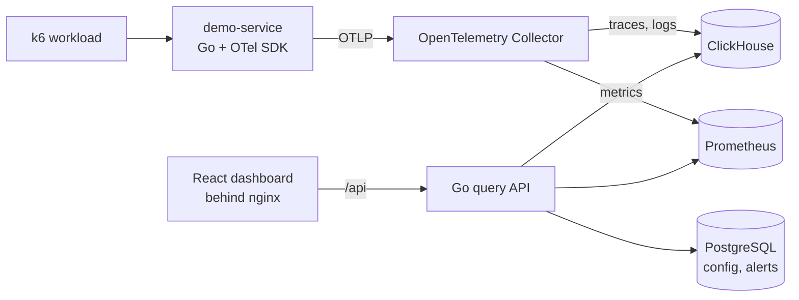

# InfraScope

**Self-hosted observability for following a slow or failing request from the HTTP call, through the services it touched, down to the database query responsible.**

InfraScope collects traces, metrics and logs with OpenTelemetry, stores them in ClickHouse and Prometheus, and puts one investigation workflow on top: service health → the trace of a bad request → the logs written during it → the operation that caused it. Signals are linked by trace ID rather than by matching timestamps, so each step is one click.

> **Status: Phase 3 — investigation UI.** The dashboard takes a slow request from the service overview to the span and statement that caused it, and to the logs written during it, and says on every page when part of the platform is down. [Browser journeys](tests/e2e/README.md) walk that investigation against the running stack in CI, beside the [pipeline test](tests/pipeline/README.md) and [integration tests](tests/integration/README.md) against real databases. Alerting comes in Phase 4 ([roadmap](docs/SPEC.md#12-roadmap)). No performance numbers are claimed until they are [measured](docs/benchmarks/README.md).

## The problem

Dashboards tell you *that* p95 latency doubled. Finding out *why* usually means jumping between a metrics tool, a tracing tool and a log search, and lining up timestamps by hand. InfraScope's job is to make that path short and exact.

## The investigation it is built around

1. Load-test the demo shop service.
2. Ship the "bad deploy": an index on the order-history query goes missing.
3. The service overview shows p95 latency rising while traffic stays flat.
4. Click the spike → the slowest traces from that window → one `SELECT` span dominates the waterfall.
5. "Logs for this trace" shows the slow-query warning written during that span.
6. Add the index (`make demo-fix`) and rerun the identical workload.
7. Compare the before and after measurements in a benchmark report.

Full script with commands: [docs/demo-script.md](docs/demo-script.md).

## Architecture



- **Ingest and query are separate.** The collector owns the write path and the API never receives telemetry ([ADR-0001](docs/decisions/0001-collector-centric-ingestion.md)).
- **Purpose-fit storage:** ClickHouse for traces and logs, Prometheus for metrics ([ADR-0002](docs/decisions/0002-clickhouse-for-traces-and-logs.md), [ADR-0003](docs/decisions/0003-prometheus-for-metrics.md)).
- **Degraded, not down:** if one store fails, only the features it serves are marked unavailable ([NFR-1](docs/SPEC.md#5-non-functional-requirements)).

Details: [docs/architecture.md](docs/architecture.md).

## Quickstart

Requirements: Docker with Compose v2. `make` is optional.

```bash
cp .env.example .env     # then change the passwords in it
make up                  # build, start, wait until healthy
make smoke               # browser → nginx → API → every dependency
```

Without `make`:

```bash
docker compose --env-file .env -f deployments/docker-compose.yml up -d --build --wait
bash scripts/smoke.sh
```

Then open <http://localhost:8080> and log in with `INFRASCOPE_ADMIN_USER` / `INFRASCOPE_ADMIN_PASSWORD` from `.env`. The [demo walkthrough](docs/demo-script.md) takes you through an investigation. The status badge in the header shows the API's live view of its dependencies and leads to the platform status page. To check the whole system end to end, run `make test-pipeline` and `make test-e2e`. All ports bind to `127.0.0.1` by default. Operations such as logs, reset, debug ports and load generation are in the [runbook](docs/runbook.md).

Try the API directly. The account is `INFRASCOPE_ADMIN_USER` / `INFRASCOPE_ADMIN_PASSWORD` from `.env`:

```bash
curl -c session.txt -H 'Content-Type: application/json' \
  -d '{"username":"admin","password":"<from .env>"}' http://localhost:8080/api/v1/auth/login
curl -b session.txt http://localhost:8080/api/v1/services
curl -b session.txt 'http://localhost:8080/api/v1/traces?service=demo-service&sort=duration&limit=5'
```

## Tech stack

| Layer | Technology | Why |
|---|---|---|
| Instrumentation | OpenTelemetry SDK (Go) | vendor-neutral traces, metrics and logs with shared trace context |
| Pipeline | OpenTelemetry Collector (contrib 0.164) | batching, retry, memory limits, back-pressure ([ADR-0001](docs/decisions/0001-collector-centric-ingestion.md)) |
| Traces and logs | ClickHouse 26.8 LTS | columnar scans, compression, TTL by partition ([ADR-0002](docs/decisions/0002-clickhouse-for-traces-and-logs.md)) |
| Metrics | Prometheus 3.15 (native OTLP) | PromQL for rates and percentiles ([ADR-0003](docs/decisions/0003-prometheus-for-metrics.md)) |
| Configuration | PostgreSQL 18 | users, sessions, alert rules and state |
| API | Go 1.27, standard library `net/http` | small, explicit, easy to test ([OpenAPI contract](apps/api/openapi.yaml)) |
| UI | React 19, TypeScript 7, Vite 8, TanStack Query, ECharts | investigation views; state in the URL |
| Delivery | Docker Compose, GitHub Actions | one-command self-hosting; CI starts the full stack |
| Testing | Go `testing`, Vitest, testcontainers-go, Playwright, k6 | [strategy](docs/SPEC.md#11-testing-strategy) |

## Project status

- [x] **Phase 0:** specification, decision records, runnable skeleton, CI
- [x] **Phase 1:** instrumented demo service and telemetry pipeline
- [x] **Phase 2:** query API (services, traces, logs, auth)
- [x] **Phase 3:** investigation UI (overview, waterfall, logs, correlation)
- [ ] **Phase 4:** alerting, failure scenarios, reliability hardening
- [ ] **Phase 5:** benchmarked v1.0 release

## Results

*Filled in at Phase 5 from measured runs.* Every number here will link to a report produced by the [benchmark method](docs/benchmarks/README.md).

## Limitations (by design)

Single node, no high availability, one admin user, no multi-tenancy. Data expires by TTL, with no long-term storage. It is not a replacement for Grafana, Jaeger or a commercial APM. See [non-goals](docs/SPEC.md#22-non-goals).

## Repository layout

```
apps/
  api/            Go query and configuration API (+ openapi.yaml)
  dashboard/      React + TypeScript UI, served by nginx
  demo-service/   instrumented Go shop: the system under observation
telemetry/        OpenTelemetry Collector and Prometheus configuration
storage/          ClickHouse and PostgreSQL configuration and init
deployments/      Docker Compose (stack + debug override)
tests/            integration, end-to-end and load tests
scripts/          smoke test and helpers
docs/             spec, architecture, ADRs, runbook, benchmarks
```

## Documentation

- [Specification](docs/SPEC.md): requirements, data model, API, security, testing, roadmap
- [Architecture](docs/architecture.md): components, flows, topology, failure modes
- [Decision records](docs/decisions/README.md)
- [Runbook](docs/runbook.md)
- [Demo walkthrough](docs/demo-script.md)
- [Benchmark method](docs/benchmarks/README.md)

## License

[MIT](LICENSE) © 2026 Kipyegon Darius
