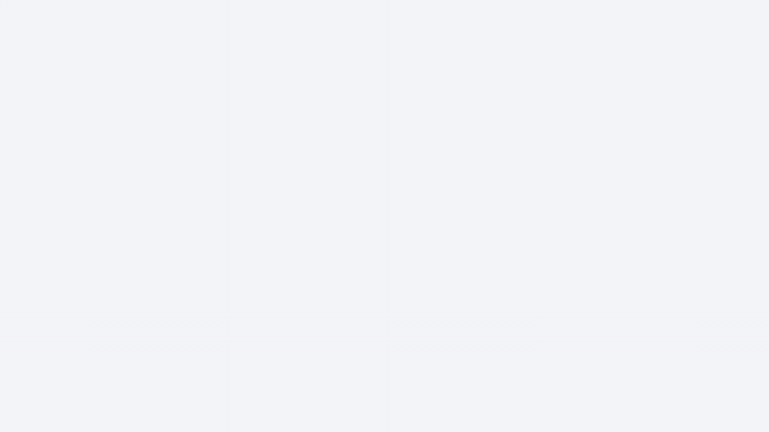
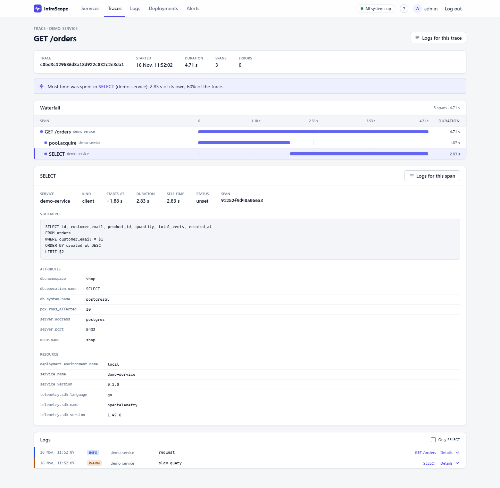
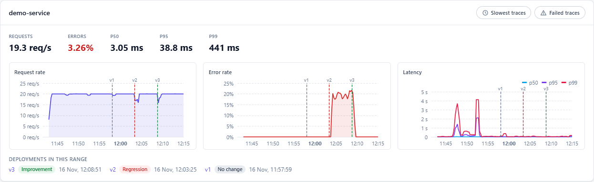
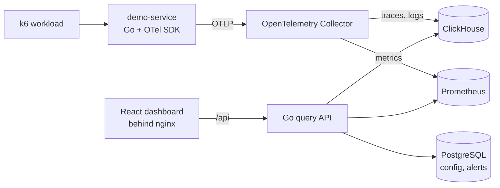

# InfraScope

**Self-hosted observability for following a slow or failing request from the HTTP call, through the services it touched, down to the database query responsible.**

InfraScope collects traces, metrics and logs with OpenTelemetry, stores them in ClickHouse and Prometheus, and puts one investigation workflow on top: service health → the trace of a bad request → the logs written during it → the operation that caused it. Signals are linked by trace ID rather than by matching timestamps, so each step is one click.

> **Status: Phase 4 — DeployRadar.** Every deployment GitHub reports is compared with the service's health before it: error rate and p95 latency in each window, a verdict, and the exact PromQL behind every number, one click from the failing traces. Phases 1–3 built the investigation that follows: from a slow request on the service overview to the span and statement that caused it, and the logs written during it, with every page saying when part of the platform is down. [Browser journeys](tests/e2e/README.md) walk that investigation against the running stack in CI, beside the [pipeline test](tests/pipeline/README.md) and [integration tests](tests/integration/README.md) against real databases. Alerting comes in Phase 5 ([roadmap](docs/SPEC.md#12-roadmap)). No performance numbers are claimed until they are [measured](docs/benchmarks/README.md).



*A release ships with one storage call in five failing. DeployRadar marks it a regression, shows which routes broke, and opens the failing requests behind it. Recorded in the [demo run](docs/results/2026-11-16-demo-run.md).*

## The problem

Dashboards tell you *that* p95 latency doubled. Finding out *why* usually means jumping between a metrics tool, a tracing tool and a log search, and lining up timestamps by hand. InfraScope's job is to make that path short and exact.

## The investigation it is built around

1. Load-test the demo shop service.
2. Ship the "bad deploy": an index on the order-history query goes missing.
3. The service overview shows p95 latency rising while traffic stays flat.
4. Click the spike → the slowest traces from that window → one `SELECT` span dominates the waterfall.
5. "Logs for this trace" shows the slow-query warning written during that span.
6. Add the index (`make demo-fix`) and rerun the identical workload.
7. Compare the before and after measurements in a benchmark report.

Full script with commands: [docs/demo-script.md](docs/demo-script.md).

In the [recorded run](docs/results/2026-11-16-demo-run.md), p95 went from 9.4 ms to 167 ms while traffic stayed at 20 requests per second, and came back to 11 ms after the fix. The slowest request spent 2.83 s of its 4.71 s in one `SELECT`, which the waterfall names, next to the slow-query warning logged during it:



## Did that deployment do it?

The same incident often starts with a release. **DeployRadar** receives GitHub's deployment webhooks and compares each successful deployment's error rate and p95 latency before and after it, in Prometheus. It gives a verdict with a confidence, names the route that changed most, and keeps the exact PromQL behind every number, so any of them can be checked ([ADR-0007](docs/decisions/0007-deployment-health-comparison.md)).

In the recorded run, a release that failed one storage call in five was marked **Regression**: error rate 0.0% → 19.5% (+19.5 pp, p<0.001) over 3,600 requests in each window. The healthy release before it read **No change**, and the fix after it **Improvement**. The overview marks each deployment on the charts:



Try it with `make demo-deploy V=v2 ERROR_RATE=0.2` ([tutorial, part 4](docs/tutorial.md#part-4-catch-a-bad-deployment)).

## Architecture



- **Ingest and query are separate.** The collector owns the write path and the API never receives telemetry ([ADR-0001](docs/decisions/0001-collector-centric-ingestion.md)).
- **Purpose-fit storage:** ClickHouse for traces and logs, Prometheus for metrics ([ADR-0002](docs/decisions/0002-clickhouse-for-traces-and-logs.md), [ADR-0003](docs/decisions/0003-prometheus-for-metrics.md)).
- **Degraded, not down:** if one store fails, only the features it serves are marked unavailable ([NFR-1](docs/SPEC.md#5-non-functional-requirements)).

Details: [docs/architecture.md](docs/architecture.md).

## Quickstart

New here? The **[tutorial](docs/tutorial.md)** takes you from a fresh clone to finding a slow query and catching a bad deployment, step by step, in about an hour.

Requirements: Docker with Compose v2. `make` is optional.

```bash
cp .env.example .env     # then change the passwords in it
make up                  # build, start, wait until healthy
make smoke               # browser → nginx → API → every dependency
```

Without `make`:

```bash
docker compose --env-file .env -f deployments/docker-compose.yml up -d --build --wait
bash scripts/smoke.sh
```

Then open <http://localhost:8080> and log in with `INFRASCOPE_ADMIN_USER` / `INFRASCOPE_ADMIN_PASSWORD` from `.env`. The [demo walkthrough](docs/demo-script.md) takes you through an investigation. The status badge in the header shows the API's live view of its dependencies and leads to the platform status page. To check the whole system end to end, run `make test-pipeline` and `make test-e2e`. All ports bind to `127.0.0.1` by default. Operations such as logs, reset, debug ports and load generation are in the [runbook](docs/runbook.md).

Try the API directly. The account is `INFRASCOPE_ADMIN_USER` / `INFRASCOPE_ADMIN_PASSWORD` from `.env`:

```bash
curl -c session.txt -H 'Content-Type: application/json' \
  -d '{"username":"admin","password":"<from .env>"}' http://localhost:8080/api/v1/auth/login
curl -b session.txt http://localhost:8080/api/v1/services
curl -b session.txt 'http://localhost:8080/api/v1/traces?service=demo-service&sort=duration&limit=5'
```

## Tech stack

| Layer | Technology | Why |
|---|---|---|
| Instrumentation | OpenTelemetry SDK (Go) | vendor-neutral traces, metrics and logs with shared trace context |
| Pipeline | OpenTelemetry Collector (contrib 0.164) | batching, retry, memory limits, back-pressure ([ADR-0001](docs/decisions/0001-collector-centric-ingestion.md)) |
| Traces and logs | ClickHouse 26.8 LTS | columnar scans, compression, TTL by partition ([ADR-0002](docs/decisions/0002-clickhouse-for-traces-and-logs.md)) |
| Metrics | Prometheus 3.15 (native OTLP) | PromQL for rates and percentiles ([ADR-0003](docs/decisions/0003-prometheus-for-metrics.md)) |
| Configuration | PostgreSQL 18 | users, sessions, deployments and their comparisons, alert rules and state |
| API | Go 1.27, standard library `net/http` | small, explicit, easy to test ([OpenAPI contract](apps/api/openapi.yaml)) |
| UI | React 19, TypeScript 7, Vite 8, TanStack Query, ECharts | investigation views; state in the URL |
| Delivery | Docker Compose, GitHub Actions | one-command self-hosting; CI starts the full stack |
| Testing | Go `testing`, Vitest, testcontainers-go, Playwright, k6 | [strategy](docs/SPEC.md#11-testing-strategy) |

## Project status

- [x] **Phase 0:** specification, decision records, runnable skeleton, CI
- [x] **Phase 1:** instrumented demo service and telemetry pipeline
- [x] **Phase 2:** query API (services, traces, logs, auth)
- [x] **Phase 3:** investigation UI (overview, waterfall, logs, correlation)
- [x] **Phase 4:** DeployRadar: each deployment's before/after health comparison, with evidence
- [ ] **Phase 5:** alerting, failure scenarios, reliability hardening
- [ ] **Phase 6:** benchmarked v1.0 release

## Results

Every number in this README links to a report.

- [Demo run, 2026-11-16](docs/results/2026-11-16-demo-run.md): one recorded run of the missing-index investigation and DeployRadar on a laptop, with the setup, the sequence and the raw figures. It shows the investigations working on real telemetry; it is not a benchmark.
- Benchmark reports (S1 before and after, repeated, on documented hardware) come with Phase 6, following the [benchmark method](docs/benchmarks/README.md).

## Limitations (by design)

Single node, no high availability, one admin user, no multi-tenancy. Data expires by TTL, with no long-term storage. DeployRadar compares one window on each side of a deployment, so a change in traffic between them can look like an effect of the deployment, and a quiet service gets `insufficient_data` rather than a verdict ([ADR-0007](docs/decisions/0007-deployment-health-comparison.md)). It is not a replacement for Grafana, Jaeger or a commercial APM. See [non-goals](docs/SPEC.md#22-non-goals).

## Repository layout

```
apps/
  api/            Go query and configuration API (+ openapi.yaml)
  dashboard/      React + TypeScript UI, served by nginx
  demo-service/   instrumented Go shop: the system under observation
telemetry/        OpenTelemetry Collector and Prometheus configuration
storage/          ClickHouse and PostgreSQL configuration and init
deployments/      Docker Compose (stack + debug override)
tests/            integration, end-to-end and load tests
scripts/          smoke test and helpers
docs/             spec, architecture, ADRs, runbook, benchmarks
```

## Documentation

- [Tutorial](docs/tutorial.md): your first hour, from clone to two investigations
- [Specification](docs/SPEC.md): requirements, data model, API, security, testing, roadmap
- [Architecture](docs/architecture.md): components, flows, topology, failure modes
- [Decision records](docs/decisions/README.md)
- [Runbook](docs/runbook.md)
- [Demo walkthrough](docs/demo-script.md)
- [Benchmark method](docs/benchmarks/README.md)

## License

[MIT](LICENSE) © 2026 Kipyegon Darius
