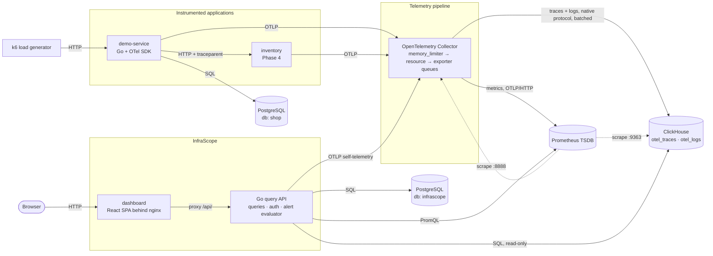
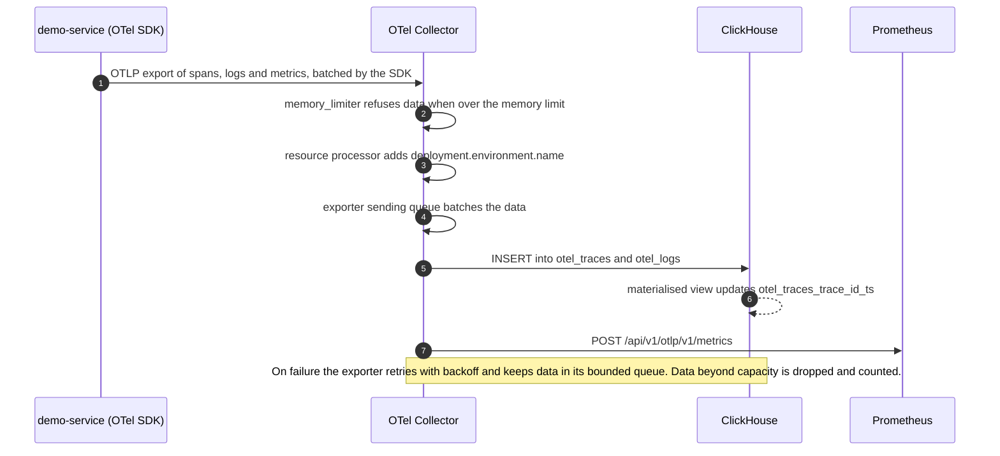
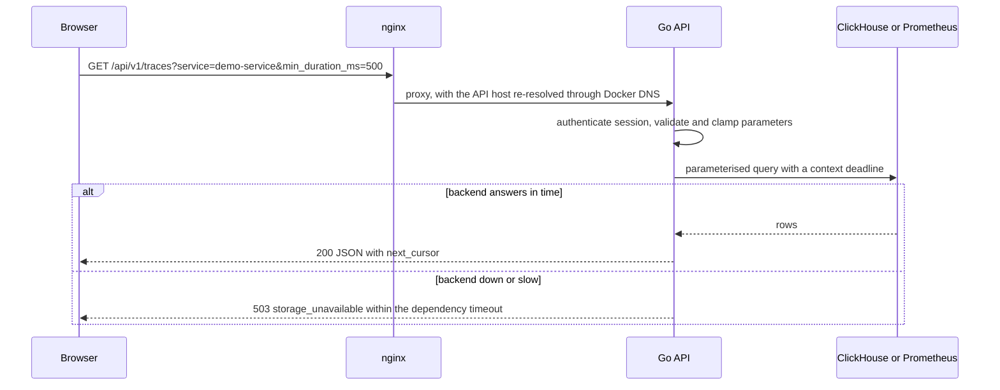
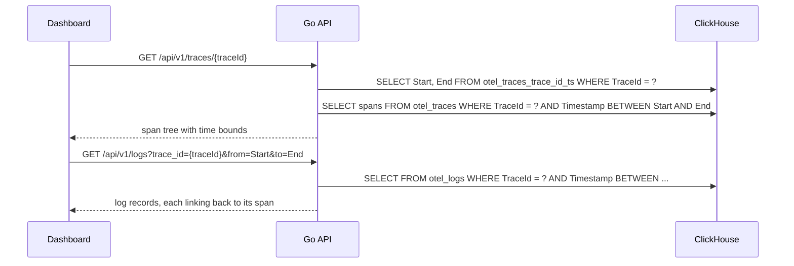
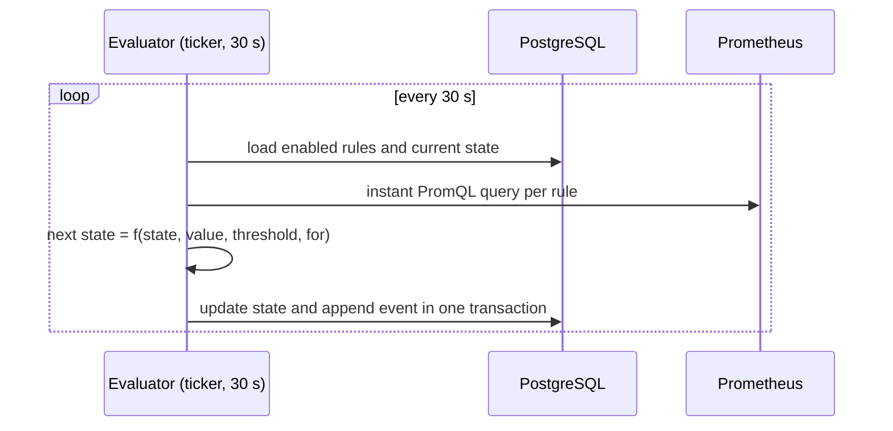

# InfraScope — Architecture

This document describes how InfraScope is put together and why. Requirements are defined in [SPEC.md](SPEC.md), and significant choices are recorded as [ADRs](decisions/README.md).

## 1. Design principles

1. **Separate ingest from query.** The OpenTelemetry Collector owns the write path, and the Go API owns the read path. Neither can overload the other ([ADR-0001](decisions/0001-collector-centric-ingestion.md)).
2. **Correlate on IDs, not timestamps.** Spans and logs share W3C trace context, so every cross-signal link is an exact ID lookup.
3. **Fail partially and visibly.** When a storage backend is down, the features it serves are marked unavailable and everything else keeps working.
4. **Bound everything.** Queues, query ranges, page sizes, timeouts and retention all have explicit limits.
5. **Measure before claiming.** Performance statements come from [benchmark reports](benchmarks/README.md), never from expectation.

## 2. Components

| Component | Technology (pinned) | Responsibility | Listens on | State |
|---|---|---|---|---|
| `demo-service` | Go 1.27, OpenTelemetry SDK | The system under observation: a toy shop API | `8082` | data in PostgreSQL `shop` |
| `otel-collector` | otelcol-contrib 0.164.0 | Receive OTLP; limit memory; enrich; batch; export | `4317` gRPC, `4318` HTTP, `13133` health, `8888` own metrics | exporter queues (in memory; on disk from Phase 4) |
| `clickhouse` | ClickHouse 26.8 (LTS) | Trace and log storage | `8123` HTTP, `9000` native, `9363` metrics | volume `clickhouse-data` |
| `prometheus` | Prometheus 3.15 | Metric storage (OTLP push + scrapes) | `9090` | volume `prometheus-data` |
| `postgres` | PostgreSQL 18 | `infrascope` (users, sessions, alert rules and state); `shop` (demo data) | `5432` | volume `postgres-data` |
| `api` | Go 1.27 (stdlib `net/http`) | Query and configuration API; alert evaluator | `8081` | stateless |
| `dashboard` | React 19 + Vite 8, served by nginx 1.30 | Investigation UI; reverse proxy for `/api/` | `8080` | stateless |
| `k6` *(profile `load`)* | k6 2.3 | Reproducible load | — | — |

## 3. Component view

`shop` and `infrascope` are two databases in one PostgreSQL instance. They have separate roles and are never mixed.

## 4. Key flows

### 4.1 Ingest path

- **Why exporter-side batching:** ClickHouse performs best with large inserts. The ClickHouse exporter documentation recommends the exporter's own `sending_queue.batch` over the standalone `batch` processor, because batches then sit in the same queue that retries and (from Phase 4) persists them.
- **Back-pressure:** when the collector is over its memory limit, `memory_limiter` makes the OTLP receiver return a retryable error. SDK exporters back off instead of the collector crashing.

### 4.2 Query path

### 4.3 Correlation: trace → logs

The time bounds turn both lookups into partition-pruned reads instead of scans across the whole retention window.

### 4.4 Alert evaluation (Phase 4)

The state transition is a pure function, which is why it can be tested exhaustively with table-driven tests ([ADR-0005](decisions/0005-alert-evaluation-in-the-api.md)).

## 5. Deployment topology

Everything runs as one Docker Compose project named `infrascope`, on its default user-defined network. Service names double as DNS names.

**Published ports.** All of them bind to `${INFRASCOPE_BIND}`, which defaults to `127.0.0.1`:

| Port | Service | Why it is published |
|---|---|---|
| `8080` | dashboard | the product UI and API entry point |
| `8082` | demo-service | drive the demo and toggle faults by hand |
| `4317`, `4318` | otel-collector | send OTLP from processes running on the host |

`deployments/docker-compose.debug.yml` additionally exposes Prometheus (`9090`), ClickHouse (`8123`, `9000`), PostgreSQL (`5432`), the API (`8081`) and the collector's health and metrics ports (`13133`, `8888`), on localhost only.

**Startup ordering and healthchecks**

| Service | Healthcheck | Waits for |
|---|---|---|
| postgres | `pg_isready -h 127.0.0.1` (TCP, so it only passes once init scripts have finished) | — |
| clickhouse | `wget --spider http://127.0.0.1:8123/ping` | — |
| prometheus | `wget --spider http://127.0.0.1:9090/-/ready` | — |
| otel-collector | none (scratch image). Readiness is reported by the API's status endpoint. | clickhouse healthy (the exporter creates the schema at startup, see [ADR-0004](decisions/0004-exporter-managed-clickhouse-schema.md)) |
| api | `api healthcheck` (the binary probes its own `/healthz`; the image is distroless) | postgres healthy, **but not** ClickHouse or Prometheus (degraded mode is by design) |
| demo-service | `demo-service healthcheck` | postgres healthy, collector started |
| dashboard | `wget --spider http://127.0.0.1:8080/healthz` | api started |

## 6. Failure modes

| Failure | Effect | Detection | Recovery |
|---|---|---|---|
| ClickHouse down | Trace and log endpoints return `503 storage_unavailable`; the overview still works. The collector queues and retries, and drops data after queue capacity or the 300 s retry window is used up. | `/api/v1/status`, dashboard banner, `otelcol_exporter_send_failed_*`, `otelcol_exporter_queue_size` | Restart ClickHouse; queued data flushes ([runbook](runbook.md#clickhouse-is-down-or-unhealthy)) |
| Prometheus down | The overview and alert evaluation stop (`503 metrics_unavailable`); traces and logs still work. The collector retries metric exports. | status endpoint, banner | Restart; alert state resumes from PostgreSQL |
| Collector down | No new telemetry arrives; stored data stays queryable. SDK exporters retry, then drop. | status endpoint; `up{job="otel-collector"} == 0` | Restart the collector |
| PostgreSQL down | Login, sessions and alerting fail; `/readyz` returns 503 because PostgreSQL is a required dependency. | `/readyz`, status endpoint | Restart; no telemetry is lost (it lives elsewhere) |
| API down | The dashboard's static assets still load; `/api/` returns 502. | status banner fails to load; container health | Restart. nginx re-resolves the API's address on each request, so no nginx restart is needed. |
| Collector memory pressure | `memory_limiter` refuses data and SDKs back off. | `otelcol_receiver_refused_*` | Raise the limit or lower the load ([runbook](runbook.md#collector-is-refusing-or-dropping-data)) |
| Disk full | ClickHouse inserts and Prometheus appends fail. | runbook disk checks | Lower the TTL or retention, or drop old partitions ([runbook](runbook.md#disk-usage-keeps-growing)) |

## 7. Configuration

| Where | What |
|---|---|
| `.env` (from `.env.example`, git-ignored) | Credentials, published ports, bind address, telemetry TTL |
| `telemetry/otel-collector.yaml` | Receivers, processors, exporters, queues, internal telemetry |
| `telemetry/prometheus.yaml` | Scrape targets, OTLP translation, retention, out-of-order window |
| `storage/clickhouse/config.d/` | ClickHouse server overrides (metrics endpoint) |
| `storage/postgres/init/` | First-start creation of the `infrascope` and `shop` databases and roles |
| `deployments/docker-compose.yml` | Images (pinned), wiring, healthchecks, volumes |

## 8. Self-observability

| Component | Signal source | Collected by |
|---|---|---|
| OTel Collector | Internal metrics at `:8888` (received, refused, sent and failed items; queue size and capacity) | Prometheus scrape |
| ClickHouse | Built-in endpoint at `:9363` (`ClickHouseMetrics_*`, `ClickHouseProfileEvents_*`) | Prometheus scrape |
| Prometheus | Its own `/metrics` (TSDB head series, samples appended) | Prometheus self-scrape |
| API | OTel traces, metrics and logs as `infrascope-api` (from Phase 2) | The pipeline it serves |
| All | `GET /api/v1/status` (per-dependency reachability and latency) | Dashboard banner, smoke test |

Monitoring the platform with itself has an obvious blind spot: if the pipeline is down, its own telemetry is too. The status endpoint probes dependencies directly, without going through the pipeline, and so it covers that gap.
