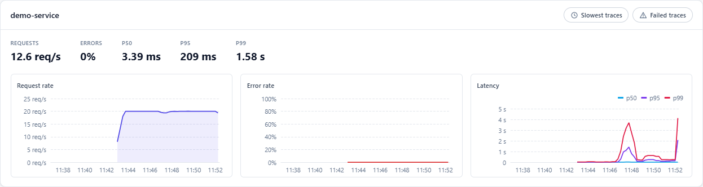
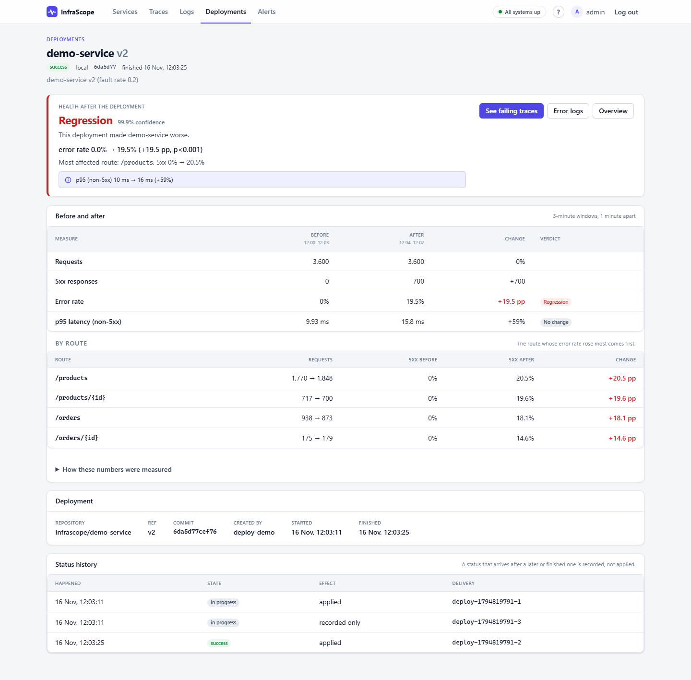

# Demo run, 2026-11-16

One recorded run of both demonstrations: scenario **S1** (the missing index) and **DeployRadar** catching a bad release. The README's pictures and numbers come from this run.

> **What this is, and is not.** It is one run on a laptop, recorded to show that the investigations work end to end with real telemetry. It is **not a benchmark**: no repeated runs, no controlled hardware, and the figures will differ from run to run. Benchmark reports follow the [benchmark method](../benchmarks/README.md).

## Setup

| | |
|---|---|
| Commit | [`6da5d77`](https://github.com/Dariuss-ctrl/InfraScope/commit/6da5d77cef761c49e1857c5e4570b56e23a433d2) |
| Machine | Intel Core i7-1065G7 (4 cores, 8 threads), 15.8 GB RAM, Windows 11 Pro |
| Docker | Engine 29.8.2, Docker Desktop VM with 8 CPUs and 7.6 GiB. Other projects on the machine were paused for the run. |
| Stack | A separate Compose project (`infrascope-repro`) from a fresh start; 1,000,000 seeded orders |
| Load | `tests/load/workload.js` at a constant 20 requests per second throughout ([request mix](../benchmarks/README.md#reference-workload)) |
| DeployRadar | `INFRASCOPE_DEPLOYRADAR_WINDOW=3m`, `INFRASCOPE_DEPLOYRADAR_SETTLE=1m` (the demo settings; the defaults are 10m and 2m) |

Sequence, in UTC:

| Time | Step |
|---|---|
| 08:42 | Stack healthy with the index in place; load starts |
| 08:46:53 | S1 on: `DROP INDEX orders_customer_email_idx` |
| 08:52:35 | S1 fixed: `CREATE INDEX CONCURRENTLY orders_customer_email_idx` |
| 08:57:59 | `make demo-deploy V=v1` (healthy) |
| 09:03:25 | `make demo-deploy V=v2 ERROR_RATE=0.2` (one storage call in five fails) |
| 09:08:51 | `make demo-deploy V=v3` (healthy) |

## S1: the missing index

The service overview's figures for `demo-service` over three 3-minute windows (`GET /api/v1/services`):

| Window | Requests | Errors | p50 | p95 | p99 |
|---|---|---|---|---|---|
| Healthy, before the drop (08:43:35–08:46:35) | 20.0 req/s | 0% | 2.9 ms | 9.4 ms | 39 ms |
| Index dropped (08:49:26–08:52:26) | 20.0 req/s | 0% | 3.7 ms | 167 ms | 459 ms |
| Fixed (08:54:35–08:57:35) | 20.0 req/s | 0% | 2.9 ms | 11.2 ms | 43 ms |



Traffic stayed flat while the tail latency rose by more than an order of magnitude, and came back after the fix. The slowest `GET /orders` request of the slow period took **4.71 s**, of which **2.83 s** was one `SELECT … FROM orders WHERE customer_email = $1 … ORDER BY created_at DESC`. The waterfall named it as the span where most of the time went, and the trace's logs included the slow-query warning written during it.

## DeployRadar

Each deployment was compared over a 3-minute window before it and a 3-minute window starting one minute after it.

| Deployment | Requests before → after | 5xx before → after | Error rate | p95 (non-5xx) | Verdict | Confidence |
|---|---|---|---|---|---|---|
| v1, healthy | 3,600 → 3,601 | 0 → 0 | 0.0% → 0.0% | 13.9 → 9.6 ms | **No change** | 94.7% |
| v2, 20% failures | 3,600 → 3,600 | 0 → 700 | 0.0% → 19.5% (+19.5 pp, p<0.001) | 9.9 → 15.8 ms | **Regression** | ≥ 99.9% |
| v3, healthy | 3,601 → 3,600 | 716 → 0 | 19.9% → 0.0% (−19.9 pp, p<0.001) | 8.1 → 8.8 ms | **Improvement** | ≥ 99.9% |



No caveat applied to any of them: request counts matched between the windows, and no two deployments overlapped. The p95 changes stayed inside the thresholds (×1.25 *and* 25 ms), so p95 was "no change" each time, and the verdicts come from the error rate.

v2's evidence by route. The fault was injected into every storage call, so every route broke at about the same rate:

| Route | Requests before | 5xx before | Requests after | 5xx after | Error rate after |
|---|---|---|---|---|---|
| `/products` | 1770 | 0.0% | 1848 | 379 | 20.5% |
| `/products/{id}` | 717 | 0.0% | 700 | 137 | 19.6% |
| `/orders` | 938 | 0.0% | 873 | 158 | 18.1% |
| `/orders/{id}` | 175 | 0.0% | 179 | 26 | 14.6% |

Every value is stored with the query behind it. For example, v2's 700 failed responses in the after window come from this instant query at 09:07:25Z:

```promql
sum(increase(http_server_request_duration_seconds_count{service_name="demo-service",deployment_environment_name="local",http_response_status_code=~"5.."}[180s]))
```

The counts are not whole numbers in the API (`increase()` extrapolates to the window's edges); they are rounded here.

## Reproduce it

Follow the [tutorial](../tutorial.md), parts 1 to 4, with the same DeployRadar settings. The [demo walkthrough](../demo-script.md) has the full script.
